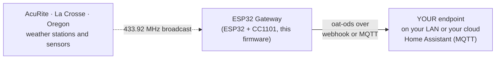

<p align="center">
  
</p>

<p align="center"><em><a href="https://openagriculturetechnology.com/">Open Agriculture Technology</a> is an open collective around one idea:<br>
appropriate technology for growing things — the right tool for the need, the budget, and the environment.</em></p>

<h1 align="center">OAT Weather-Station Listener</h1>

<p align="center"><strong>Hear the AcuRite, La Crosse or Oregon Scientific station you already own, and keep every reading.</strong><br>
One sketch in the <a href="../">OAT Sketch Library</a> — they all share one setup flow and push the same open
<a href="https://openagriculturetechnology.com/standard/">oat-ods</a> format to an endpoint you own.</p>

<p align="center">
  
  
  
  
  
  
  <a href="https://openagriculturetechnology.com/build/sketches/weather-station-listener/"></a>
</p>

---

**Flash this sketch onto an ESP32 with a two-dollar 433 MHz receiver or a
five-dollar CC1101 radio and the board becomes a weather-station gateway.** The node hosts its own setup page: join its
Wi-Fi and configure everything in your browser — no app, no account, no code
editing. It hears the one-way broadcasts of the consumer weather
stations and outdoor sensors a grower already owns. One source, five builds.
For the AcuRite Iris (5-in-1), two that both work on our bench with the same
decoder of our own: a CC1101 (Build 4, the better radio) or a bare receiver on
one pin (Build 1). A CC1101 with the
[rtl_433](https://github.com/merbanan/rtl_433) project's on-off-keying decoders
hears the 433 MHz long tail — AcuRite's line, La Crosse TX141, Oregon
Scientific, the older Fine Offset arrays (beta, not yet run on our bench); and
a CC1101 FSK build for the Ecowitt / Ambient, La Crosse View and Bresser
families compiles and waits for its first sensor. Each build maps every
value onto the OAT vocabulary, and pushes it to an endpoint you own, by webhook
or MQTT, or into [Home Assistant](https://openagriculturetechnology.com/home-assistant/weather-station/)
over MQTT (one topic per reading, declared in YAML). The [BLE Listener](../oat-ble-listener/)'s sibling, tuned to
the band where the outdoor sensors live. A live
[Test Endpoint](https://iot-test.openagriculturetechnology.com/) is ready to
catch your first reading ([Set it up](#set-it-up), step 4).



Every OAT sketch shares one core: the same setup page and captive portal, the
same Wi-Fi flow, the same push engine (HTTPS-preferred, HMAC-signed, batched),
the same 60-second health heartbeat, and the same two-way USB console. **Set up
one OAT node and you have set up all of them** — only the radio read differs.

**[Flash it from the browser](https://openagriculturetechnology.com/build/sketches/weather-station-listener/)** —
the site page installs it over USB via ESP Web Tools (Chrome or Edge), and the
node's own setup page handles the rest. No IDE needed — or build from source
(below), if that's more your speed.

## The decoders are not ours

They are the rtl_433 project's, ported to the ESP32 as
[rtl_433_ESP](https://github.com/NorthernMan54/rtl_433_ESP) (GPL-3.0): about
220 on-off-keying device types, refreshed from the rtl_433 tree. This sketch
wraps them as a driver on the OAT node core; the sketch itself is the map from
a decoder's JSON to the OAT vocabulary, and the station table. Nothing here
decodes a radio protocol, and nothing here should: a new station is a decoder
upstream, not a sketch release.

## Set it up

1. **Flash from the browser** at the
   [sketch's site page](https://openagriculturetechnology.com/build/sketches/weather-station-listener/)
   (Chrome or Edge, ESP Web Tools) — pick the button that matches your board
   and radio (table below) — or build it yourself (see Build, below).
2. Join the node's own Wi-Fi (`OAT-Setup-…`) and its setup page walks you
   through Wi-Fi, delivery (webhook URL **or** MQTT), and naming. Leave the
   **band** at 433.92; that is where AcuRite, La Crosse and Oregon Scientific
   broadcast. The radio hears one band at a time.
3. Watch **Stations heard** on the same page. Your station appears on its next
   broadcast with its model, signal and how long ago; give it a minute. A
   shared band includes the neighbours' stations — the optional **allow-list**
   takes the ids you see there and reports those alone.
4. **Watch it land.** Point the node at the live
   [Open Agriculture Technology Test Endpoint](https://iot-test.openagriculturetechnology.com/) —
   enter `https://iot-test.openagriculturetechnology.com/ingest` as the endpoint
   URL. (The push engine is HTTPS-preferred; if TLS ever won't fit the chip's
   memory it falls back to signed HTTP on its own — the oat1 signature keeps
   even that safe. You just enter the URL.) Then open the console and pick your
   farm — the gateway name you set at setup: **your gateway and every station it
   hears are there, live** — wind, rain, temperature, charts, heartbeat. No
   account, no registration; showing up in the data is the registration. It's a
   proof-of-life bench (readings are kept about an hour): prove your chain
   works, then point the node at an endpoint you keep. Want a per-message
   schema verdict instead? The
   [conformance sandbox](https://openagriculturetechnology.com/standard/test-endpoint/)
   checks every POST against the standard.

## Boards and radios

Images are named by env, not by chip, because two boards can share a chip
family and differ in the radio. The installer button on the site is captioned
by what the board is electrically.

| Env | Board | Radio | Status |
|---|---|---|---|
| `esp32` | ESP32 (classic) devkit | CC1101 — SCK 18 · MISO 19 · MOSI 23 · CS 5 · GDO0 22 · GDO2 4 · 3V3 · GND | beta |
| `esp32-s3` | ESP32-S3 devkit | CC1101 — SCK 12 · MISO 13 · MOSI 11 · CS 10 · GDO0 9 · GDO2 8 | beta |
| `esp32-c3` | ESP32-C3 devkit | CC1101 — SCK 4 · MISO 5 · MOSI 6 · CS 7 · GDO0 10 · GDO2 3 | beta |
| `esp32-c6` | ESP32-C6 devkit | CC1101 — SCK 6 · MISO 2 · MOSI 7 · CS 18 · GDO0 10 · GDO2 11 | beta |
| `heltec-v2` | Heltec WiFi LoRa 32 V2 | its own SX1276 — nothing to wire | beta |
| `heltec-v3` | Heltec WiFi LoRa 32 V3 | CC1101 on spare pins — SCK 5 · MISO 6 · MOSI 7 · CS 4 · GDO0 3 · GDO2 2 (the V3's SX1262 cannot demodulate OOK) | beta |
| `esp32-cc1101-5n1` | ESP32 (classic) + CC1101 sold as 433 MHz — SCK 18 · MISO 19 · MOSI 23 · CS 5 · GDO0 22 · 3V3 · GND | Build 4: our AcuRite 5-in-1 decoder (lib/oat_rf433), no rtl_433 | **tested** — two Iris stations since 2026-09-26; the better radio for an Iris |
| `ibc-v102` | ESP32 (classic), a bare 433 MHz superheterodyne receiver, DATA on GPIO 33 | Build 1: the same AcuRite 5-in-1 decoder | **tested** — an AcuRite Iris decoded and landed at the endpoint (1.0.6); 1.4.0 benches 2026-10-25 |
| `ibc-v102-cc1101` | ESP32 (classic) + CC1101 on alternate pins — SCK 32 · MOSI 27 · MISO 35 · CS 25 · GDO0 33 · GDO2 36 | the full decoder set | beta |

Every CC1101 / SX1276 env above has an **`-fsk` twin** (`esp32-fsk`,
`esp32-s3-fsk`, `esp32-c3-fsk`, `esp32-c6-fsk`, `heltec-v2-fsk`, `heltec-v3-fsk`,
`ibc-v102-cc1101-fsk`) on the same pins: the same source with
`-DOOK_MODULATION=false` and a 915.00 default band. Status of every one:
**built 2026-09-18, not yet heard a sensor**, so the site does not offer them;
`build.sh` keeps them in `bench/`. `esp32-fsk-bench` adds the library's heap
reporting for a soak test. The `heltec-v3` pin map is for the **V3 only**: on a
Heltec V4, GPIO 2, 5 and 7 belong to the LoRa front-end module.

*Tested* means a reading reached the endpoint on that board. The bare-receiver
path exists because a superheterodyne module has no signal level for the
rtl_433 library to gate on; it runs a sketch-local decoder for the AcuRite
5-in-1 (Iris) and hands the fields to the same map as every other path.

**Build 4 (1.4.0, on the main page since 2026-10-24):** a CC1101 on the `esp32` wiring (SCK 18, MISO 19,
MOSI 23, CS 5, GDO0 22), programmed by the sketch itself as a plain receiver,
with GDO0 read as a data pin by that same decoder — env `esp32-cc1101-5n1`. The
rtl_433 CC1101 path heard nothing on 433 (2026-09-20: its signal-strength gate
drops every on-off-keying 0 bit); this one decoded both of our Iris stations on
2026-09-26 and heard one the bare receiver beside it barely could. From 1.3.0
the bare receiver and build 4 share a decoder that reads the frame on the
station's ~628 us bit clock, fills pulses the receiver's slicer shrank to
nothing, splits pulses it merged, holds a station id until it is heard twice,
and holds an implausible jump until the next frame agrees. On 2026-10-24 Build 4
heard the farther station in 44 of 60 minutes; the bare receiver beside it, still
on 1.0.6, heard it in 2. Both are offered: Build 4 as the better choice, Build 1
because it works and costs less. `*-bench` envs add the live-tuning and `capture`
commands and stay on the bench page.

**Build 5 (1.4.4; first shipped 1.4.0):** Ecowitt / Ambient Weather sensors through a
**915 MHz CC1101 in packet mode**, env `esp32-cc1101-ecowitt-fsk`, built with
`-DOAT_RX_FSK915`. The chip does the radio work in hardware: 2-FSK at 17.24
kBaud, the bit clock, the `2d d4` sync word, fixed 24-byte frames with its RSSI
appended. The sketch polls the FIFO over SPI (`lib/oat_rf915`) and checks each
frame with the sensor's own CRC-8 and SUM-8 in our decoders for the WH31
(0x30 / 0x37), WH51 (0x51), WN34 / WN38 (0x34 / 0x38) and WH52 (0xA2).
rtl_433_ESP is not linked, and only SPI is wired: SCK 18 · MISO 19 · MOSI 23 ·
CS 5 · **3V3** (the module's limit is 3.6 V) · GND. Console: `families`,
`raw on|off`, `rssi`, `regs`, `tune bw|drate|dev`.

Heard on our bench beside an Ecowitt GW1100B posting the same sensors: a WH31B,
two WH51 and a WN34 (2026-10-04) and a WH52 (2026-11-06), every value equal to
the gateway's. The WH52 sends soil moisture, soil temperature, conductivity in
the gateway's 10 µS/cm steps (12 bits above byte 10, × 10; checked 80 to
340 µS/cm across two pots; rtl_433's `/ 25.6` read about 7 % high there) and the
raw moisture count as `moisture_ad`. **No battery voltage for the WH52 yet:** the
byte rtl_433 uses read 0x95 on our probe against the gateway's 1.58 V.

Why a second path beside the `esp32-wh51` / `esp32-fsk` images: the 2026-09-20
rtl_433 run through a 433-matched module found the preamble, the sync and the
sensor families but not their checksums, and on 2026-10-04 the rtl_433 FSK image
on a 915 module still decoded none. Packet mode does not depend on that answer:
the chip times the bits.

The images the site offers demodulate **OOK**. The Fine Offset family sold
today as Ecowitt and Ambient Weather (WS-2902 / WH65 arrays, WS80 / WS85 / WS90,
WH51 and WH52 soil, WH31 / WN34 probes, WH40 rain, WH57 lightning, WH55 leak,
WH43 / WH45 / WH46 air quality) is **FSK, every sensor of it, on every carrier
it is sold on** — 915 MHz in the Americas and Oceania, 868 in Europe, 433
elsewhere — so the band is a setting and the modulation is the image. So are La
Crosse View (LTV) and IT+ (TX29-IT, TX35) and the Bresser 5/6/7-in-1 family.
The `-fsk` envs link those decoders; they have not been proven on hardware, so
they are not offered or claimed. No decoder exists in this library build for
the Ecowitt WN30, WN35, WN36, WH41 or WFC01. A radio cannot do both modulations
at once. A quarter-wave wire antenna is 17.3 cm at 433 MHz, 8.6 cm at 868,
8.2 cm at 915; buy the CC1101 module sold for your band.

rtl_433_ESP is **pinned** in `platformio.ini` to commit `236c816` (2026-09-02),
the tree these images were built from: 223 OOK and 153 FSK decoders registered.
The site's device table is generated from those two registration lists, not
typed.

## What it sends

The station's own id is the stream id — `<model-slug>:<id>[-<channel>]`, e.g.
`acurite-5n1:748-A` — so the listener names nothing and your endpoint owns the
map from ids to places. A decoder's keys are mapped onto the shared vocabulary,
with the unit conversion built into the row (`wind_avg_km_h` → `wind_speed` in
m/s, `rain_in` → `rain_total` in mm, `temperature_F` → `temperature` in °C):

| measurement | unit | fold | from |
|---|---|---|---|
| `temperature`, `humidity` | `Cel`, `%RH` | mean | every station |
| `wind_speed`, `wind_gust`, `wind_direction` | `m/s`, `m/s`, `deg` | mean, max, last | anemometers |
| `rain_total`, `rain_rate` | `mm`, `mm/h` | cumulative, mean | rain gauges (see below) |
| `uv_index`, `illuminance`, `solar_radiation` | —, `lx`, `W/m2` | mean | arrays |
| `soil_moisture`, `soil_conductivity`, `leaf_wetness` | `%`, `uS/cm`, `%` | mean | garden soil probes (OOK); Ecowitt WH51 / WH52 on Build 5 |
| `mains` | — | state | sensors that report external power (Ecowitt WH45) |
| `lightning_total`, `lightning_distance` | —, `km` | cumulative, last | AcuRite Atlas |
| `pm25`, `pm10`, `co2`, `pressure`, `water_level` | `ug/m3`, `ppm`, `hPa`, `cm` | mean | mapped; OOK barometers and depth sensors where rtl_433 has them |
| `battery_low`, `water_leak` | — | state | every station; leak sensors where rtl_433 has them |
| `voltage`, `rssi` | `V`, `dBm` | last | where the decoder reports them |

Anything numeric the map does not know is forwarded **raw** under the decoder's
own key and listed on the status page so it can be promoted — nothing a station
measured is silently discarded. **`rain_total` is the station's running counter**
(an AcuRite reports tips of 0.01 in since its last battery pull): your endpoint
subtracts consecutive values for rainfall and treats a drop as a reset — the
rule is spelled out in the
[developer reference](https://openagriculturetechnology.com/standard/reference/).

```json
{
  "stream": "acurite-5n1:748-A",
  "measurement": "wind_speed",
  "value": 2.31,
  "unit": "m/s",
  "agg": { "window_s": 300, "samples": 16, "method": "mean" },
  "source": { "physical_id": "acurite-5n1:748-A", "brand": "AcuRite",
              "model": "Acurite-5n1", "rssi": -68 }
}
```

This is [**oat-ods**](https://openagriculturetechnology.com/standard/); the full
contract — batch envelope, field tables,
[JSON Schema](https://openagriculturetechnology.com/standard/oat-ods-0.3.schema.json),
sample payloads — lives in the
[developer reference](https://openagriculturetechnology.com/standard/reference/).

## The parts that matter

- **Two outputs, one firmware.** With Wi-Fi and an endpoint configured, this is
  an OAT gateway. With nothing configured it still prints every reading on the
  USB serial port in the oat-line grammar, so cabled to a
  [LoRa Field Node](../oat-lora-field-node/)'s pod port — or the
  [LoRa Gateway](../oat-lora-gateway/)'s — it is a pod: the station in the far
  field rides to the house over LoRa under the same stream ids. Same decoder,
  same ids; the difference is configuration.
- **A station that goes quiet is let go.** After ten silent minutes its stream
  is released and the row is marked silent; it files straight back in when
  heard again. A neighbour's sensor that drifted past, or a dead battery, never
  holds a slot for the life of the node.
- **No fake signal levels.** A bare receiver has no RSSI, so on that path the
  link metadata is left unset and the table shows a dash, rather than 0 dBm.
- **The band is a runtime setting.** Changing it re-initialises the receiver
  (the library owns the radio's task and buffers; `end()`/`begin()` is the one
  clean way to retune). A bare-receiver image's band is fixed by its module.
- **Home Assistant.** Point the node at your broker and declare each reading as
  an MQTT sensor in YAML (`oat/<name>/<station>/<measurement>`, value from
  `value_json.value`); the sketches send no discovery announcements. The
  [weather-station guide](https://openagriculturetechnology.com/home-assistant/weather-station/)
  covers three routes, including stations that only talk to their own hub.

## Files

| File | What it is |
|---|---|
| `oat_weather_listener.ino` | The firmware source (Arduino / ESP32): the vocabulary map, the station table, the bare-receiver decoder. |
| `platformio.ini` | Eight envs (four devkits, two Heltecs, two bare-receiver variants). Pinned libs (rtl_433_ESP, RadioLib, ArduinoLog). |
| `merge_bin.py` | Post-build hook → one **merged factory image** per env at `out/firmware-<env>.bin`, flashable at offset 0. |
| `make_manifest.py` | Assembles `manifest.json` + one `manifest-<env>.json` per board. |
| `build.sh` | Builds, then copies bins + manifests + source downloads into the site assets. |
| `docker-build.sh` | The same compile with no host toolchain (Docker + PlatformIO). |

## Build

**You don't need this section to use the node** — it flashes from the browser
on [its site page](https://openagriculturetechnology.com/build/sketches/weather-station-listener/).
Building it yourself:

```bash
pipx install platformio        # or: pip install --user platformio
./build.sh                     # every env
```

No host toolchain?

```bash
./docker-build.sh "-e esp32"   # one env, compiled in Docker
SKIP_BUILD=1 ./build.sh        # then the asset steps
```

Two build facts worth knowing: rtl_433_ESP names the SPI bus `VSPI` on chips it
does not list, so the C6 env aliases it (`-DVSPI=FSPI`); and the library needs a
transceiver it can read RSSI from (CC1101, SX127x) — a bare receiver on a data
pin gets the sketch-local decoder path (`-DOAT_RX_DATAPIN=<gpio>`) with
rtl_433_ESP not linked.

## FAQ

**Which weather stations does it hear?**
It depends on the build. Builds 4 (CC1101) and 1 (bare receiver): the AcuRite
5-in-1 (Iris), with one decoder of ours; both heard on our bench, the CC1101 the
better radio. The CC1101 on-off-keying images:
any OOK device rtl_433 decodes — AcuRite Iris, Atlas and tower sensors, La
Crosse TX141, Oregon Scientific, Nexus, TFA, the older Fine Offset WH1080
arrays. Not the Fine Offset family sold today as Ecowitt and Ambient Weather,
nor La Crosse View or the Bresser 5-in-1 family: those are FSK and need the
`-fsk` build, which is not offered yet. Davis stations frequency-hop and are better read
from a WeatherLink Live; a Tempest talks to its own hub; Netatmo is cloud-only.
The site page keeps the list current.

**Do I need to pair anything?**
No. These stations broadcast their readings to anyone listening — that is how
their own displays work. The listener reports what it hears; nothing on the
station is touched.

**Can it hear 433 and 915 MHz at once?**
No. One radio, one band at a time, set on the setup page. And one modulation
per image: an AcuRite (on-off keying) and an Ecowitt (FSK) cannot share a board
whatever bands they are on. Two listeners is the answer for a farm with both.

**Why is my rain total going up forever?**
Because that is what the station reports: a running tip counter. Rainfall is
the difference between consecutive values; a drop means the station reset. Your
endpoint does that subtraction, and the developer reference says exactly how.

**Why is the AcuRite only heard indoors on the bare receiver?**
A superheterodyne module is far less sensitive than a CC1101 or an SDR dongle.
Tens of metres, line of sight, is its range. For a station on a post across the
field, use a CC1101 image, or ride the listener on a LoRa node's pod port.

## License

The bundled decoders are GPL-3.0 via rtl_433_ESP, so a **distributed** binary
of this sketch is GPL-governed — which is exactly why this source ships openly.
Unlike its Apache-2.0 siblings in this library, treat this sketch as GPL-3.0
when you distribute builds of it. Keep it open; it's the right posture for OAT
anyway.

## Related

- [`oat-ble-listener/`](../oat-ble-listener/) — the same idea on Bluetooth.
- [`oat-lora-field-node/`](../oat-lora-field-node/) — carries this listener's readings over LoRa from the far field.
- [`oat-lora-gateway/`](../oat-lora-gateway/) — takes this listener on its pod port at the house.
- [`../lib/oat_ods/`](../lib/oat_ods/) — the shared oat-ods encoder + measurand vocabulary.
- [The oat-ods standard](https://openagriculturetechnology.com/standard/reference/) — the wire format.

---
*Docs: CC BY 4.0 · An [OAT](https://openagriculturetechnology.com/) sketch — an OpenCDC initiative.*
